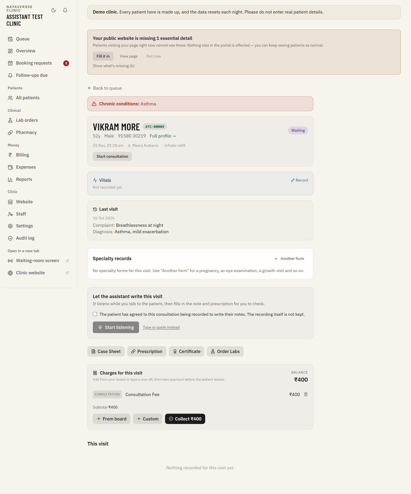
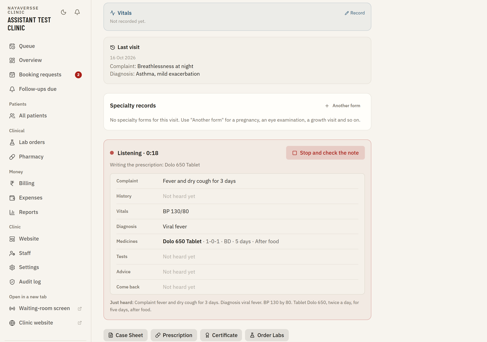
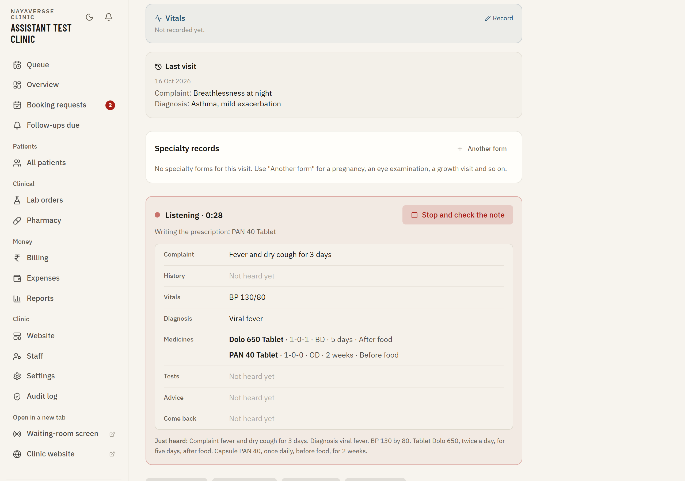
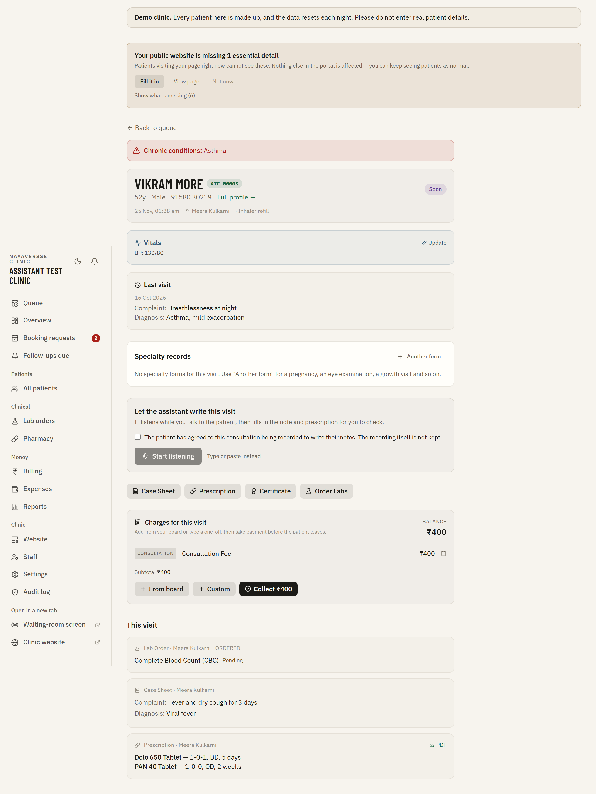
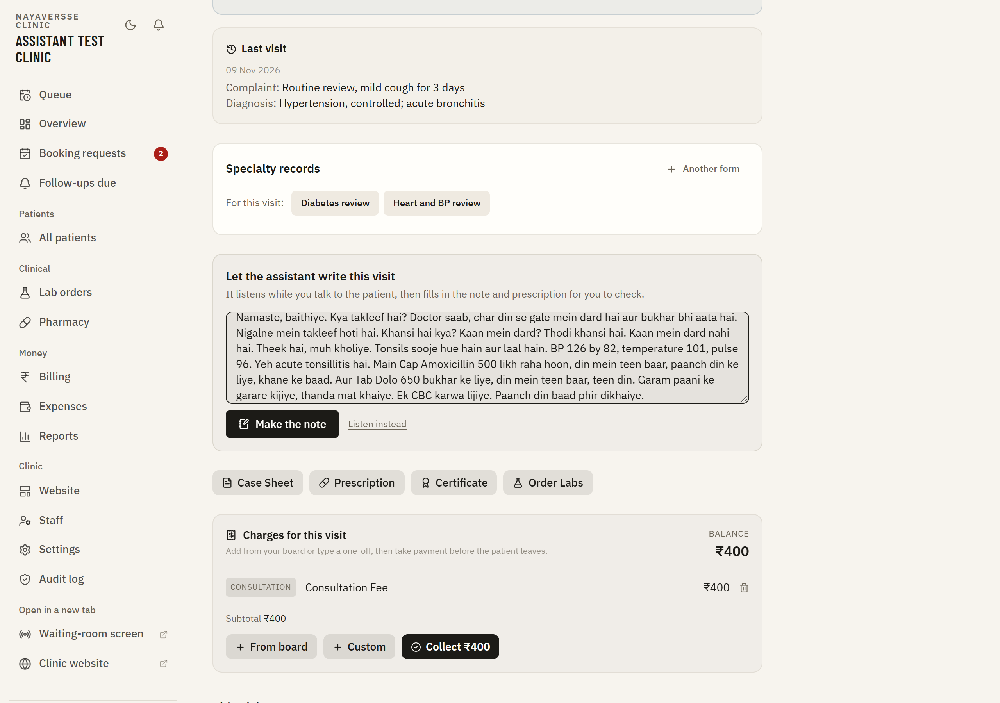
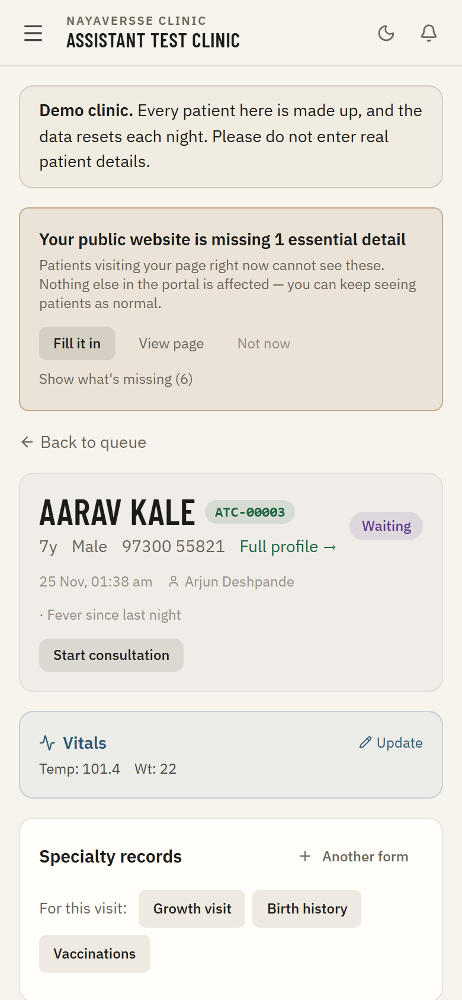

# Clinic assistant: test run, 25 November 2026

A full run of the assistant in a real Chrome browser, against the real
speech service (Sarvam Saaras v4) and the real language model (Claude
Haiku 5.5), on a throwaway local database with made-up patients.

The raw numbers behind everything below are in [results.json](results.json).

## What was tested, and how

| | |
|---|---|
| Browser | Chrome, driven by a script, desktop (1280 px) and phone (390 px) |
| Microphone | Chrome's test microphone, fed a 25-second recording of a computer voice reading a dictation in English, followed by silence |
| Database | A local Postgres made for this test: 14 invented patients, the 246,068-medicine catalogue, 23 lab tests |
| Automated tests | 91 in the clinic API (38 of them for the assistant), all passing |

## 1. Listening: the note writes itself while the doctor talks

The doctor ticks consent, taps **Start listening** and talks. The speech
is cut at each pause and sent, so the note on screen fills in a few
seconds after each thing is said.

| When | What was heard | What appeared on screen |
|---|---|---|
| 6 s | "Complaint fever and dry cough for 3 days. Diagnosis viral fever." | Complaint, Diagnosis |
| 15 s | "BP 130 by 80. Tablet Dolo 650, twice a day, for five days, after food." | BP 130/80, Dolo 650 Tablet · 1-0-1 · BD · 5 days · After food |
| 21 s | "Capsule PAN 40, once daily, before food, for 2 weeks." | PAN 40 Tablet · 1-0-0 · OD · 2 weeks · Before food |
| 29 s | "Do a CBC review after one week." | CBC ordered, follow-up in 7 days |

Every word was heard correctly. The silence after the dictation was not
sent to the speech service, so it was not paid for.

Before starting:

Ten seconds in:

Eighteen seconds in, the first medicine being written:

Twenty-eight seconds in:

## 2. Stop: the note becomes the doctor's to check

On **Stop and check the note** the same note opens as an editable form,
0.4 seconds later. Each medicine shows the words it was heard in. This
note was read by the assistant's own rules, so it cost nothing in
language-model fees.

## 3. Confirm: the visit's records are written

**Confirm and save** wrote the case sheet, the prescription (2 medicines)
and the lab order together, and marked the visit as seen. A second
confirm of the same note was refused.

## 4. A Hindi-English conversation, and an allergy

A typed conversation in Hindi and English, on a patient whose file lists
a penicillin allergy. The doctor in the conversation prescribes
amoxicillin.

The language model wrote the note in 6.7 seconds:

- Complaint: Sore throat x 4 days with fever
- History: Sore throat x 4 days, fever, painful swallowing. Mild cough. No ear pain. On examination: tonsils swollen and red.
- Diagnosis: Acute tonsillitis
- Vitals: BP 126/82, temperature 101, pulse 96
- Medicines: amoxycillin 500 mg 1-1-1 for 5 days after food; Dolo 650 1-1-1 for 3 days
- Tests: CBC. Follow-up: 5 days.

The amoxycillin line carries a red warning: the patient's file lists an
allergy to penicillin and this medicine may be related to it. The draft
was discarded, and nothing was saved.

## 5. On a phone

A dictated children's note at 390 px wide, read by rule in 0.15 seconds.
No part of the page scrolls sideways.

## What this run does not show

- **Real Hindi or Marathi speech.** The laptop has only English computer
  voices, so the spoken test was in English. The Hindi-English
  conversation was typed, not spoken.
- **A real consulting room.** No background noise, no second speaker, no
  phone lying on a desk.
- **The language model writing while listening.** The dictation named its
  own sections, so the rules were enough and the model was not called
  during listening. The mid-consultation model pass is built and unit
  tested, and has not been watched in a browser.
- **A real doctor's speed of speech and habits.**

## Faults this run found

| Fault | State |
|---|---|
| Every file upload in the app could hang for ever when an error followed the upload | Fixed |
| The note only appeared after Stop, not while talking | Fixed: it now fills in at each pause |
| A dose was left blank for "din mein teen baar" | Fixed |
| "Tab Azithromycin 500 roz" was read with "roz" in the name | Fixed |
| An allergy written as a family ("Penicillin", "Sulfa drugs") did not flag a member of it | Fixed for penicillins, sulfa drugs, NSAIDs, cephalosporins, quinolones |
| Vitals in the draft had no labels once filled in | Fixed |
| A medicine said by its salt ("Amoxicillin 500", "Zinc 20") is matched to one arbitrary brand | Open. It is flagged as a close match and other brands are offered, but the first pick is not meaningful. |

## What it cost

| | |
|---|---|
| Speech-to-text, 25 seconds | about ₹0.20 at ₹0.49 a minute |
| Language model, one conversation | about 2,500 tokens in and 1,300 out on Claude Haiku 5.5: roughly 8 paise |
| A dictated note with named sections | nothing beyond the speech-to-text |
