# Clinic assistant: test run, 25 November 2026

A full run of the assistant in a real Chrome browser, against the real
speech service (Sarvam Saaras v4) and the real language model (Claude
Haiku 5.5), on a throwaway local database with made-up patients.

The raw numbers behind everything below are in [results.json](results.json).

## What was tested, and how

| | |
|---|---|
| Browser | Chrome, driven by a script, desktop (1280 px) and phone (390 px) |
| Microphone | Chrome's test microphone, fed a 25-second recording of a computer voice reading a dictation in English, followed by silence |
| Database | A local Postgres made for this test: 14 invented patients, the 246,068-medicine catalogue, 23 lab tests |
| Automated tests | 91 in the clinic API (38 of them for the assistant), all passing |

## 1. Listening: the note writes itself while the doctor talks

The doctor ticks consent, taps **Start listening** and talks. The speech
is cut at each pause and sent, so the note on screen fills in a few
seconds after each thing is said.

| When | What was heard | What appeared on screen |
|---|---|---|
| 6 s | "Complaint fever and dry cough for 3 days. Diagnosis viral fever." | Complaint, Diagnosis |
| 15 s | "BP 130 by 80. Tablet Dolo 650, twice a day, for five days, after food." | BP 130/80, Dolo 650 Tablet · 1-0-1 · BD · 5 days · After food |
| 21 s | "Capsule PAN 40, once daily, before food, for 2 weeks." | PAN 40 Tablet · 1-0-0 · OD · 2 weeks · Before food |
| 29 s | "Do a CBC review after one week." | CBC ordered, follow-up in 7 days |

Every word was heard correctly. The silence after the dictation was not
sent to the speech service, so it was not paid for.

Before starting:

Ten seconds in:

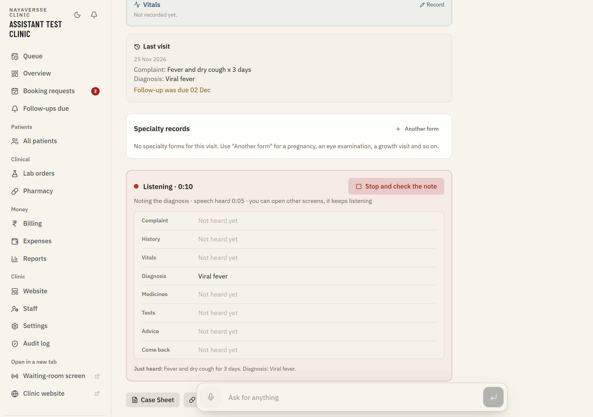

### The doctor can leave the visit and it keeps listening

Mid-recording, the test opens **All patients**, as a doctor would to look
something up. The listening does not stop. A bar at the bottom of every
screen shows who is being listened to, for how long, what is being
written and how much speech has been heard, with a Stop button.

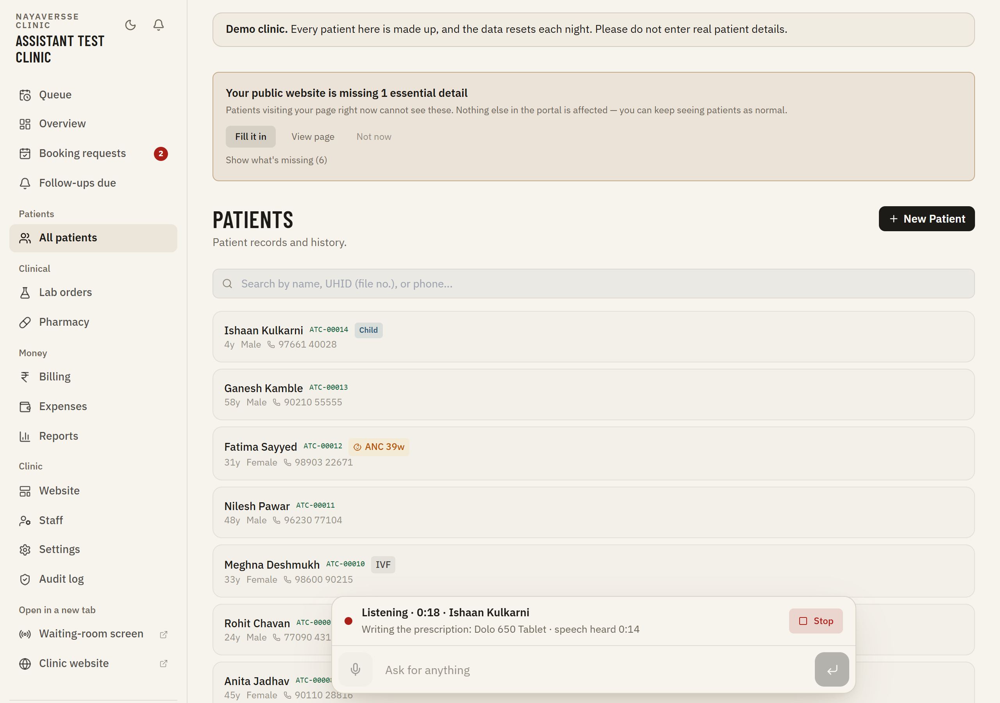

Tapping the bar goes back to the visit, where the note has kept filling
in while the doctor was away:

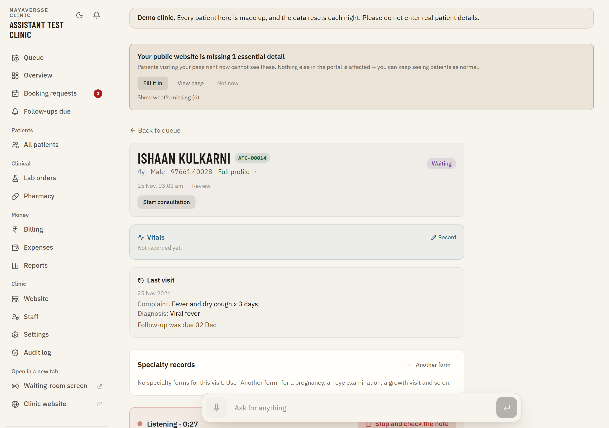

The timings in the table above are from an earlier run of the same
recording; this run's are in results.json and differ by a second or two.

## 2. Stop: the note becomes the doctor's to check

On **Stop and check the note** the same note opens as an editable form.
Each medicine shows the words it was heard in. When the rules alone can
read the whole note this takes under half a second and costs nothing in
language-model fees; in the last run the microphone clipped the first
word, the rules could not place the complaint, and the language model
read it through instead, which took 6.7 seconds.

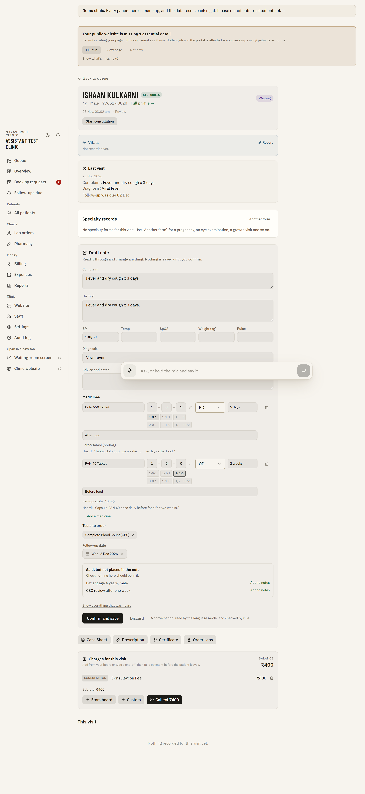

## 3. Confirm: the visit's records are written

**Confirm and save** wrote the case sheet, the prescription (2 medicines)
and the lab order together, and marked the visit as seen. A second
confirm of the same note was refused.

## 4. A Hindi-English conversation, and an allergy

A typed conversation in Hindi and English, on a patient whose file lists
a penicillin allergy. The doctor in the conversation prescribes
amoxicillin.

The language model wrote the note in 6.7 seconds:

- Complaint: Sore throat x 4 days with fever
- History: Sore throat x 4 days, fever, painful swallowing. Mild cough. No ear pain. On examination: tonsils swollen and red.
- Diagnosis: Acute tonsillitis
- Vitals: BP 126/82, temperature 101, pulse 96
- Medicines: amoxycillin 500 mg 1-1-1 for 5 days after food; Dolo 650 1-1-1 for 3 days
- Tests: CBC. Follow-up: 5 days.

The amoxycillin line carries a red warning: the patient's file lists an
allergy to penicillin and this medicine may be related to it. The draft
was discarded, and nothing was saved.

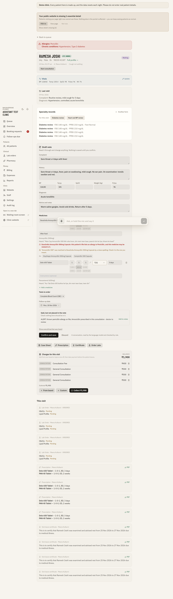

## 5. On a phone

A dictated children's note at 390 px wide, read by rule in 0.15 seconds.
No part of the page scrolls sideways.

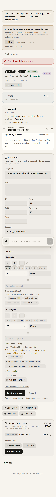

## What this run does not show

- **Real Hindi or Marathi speech.** The laptop has only English computer
  voices, so the spoken test was in English. The Hindi-English
  conversation was typed, not spoken.
- **A real consulting room.** No background noise, no second speaker, no
  phone lying on a desk.
- **The language model writing while listening.** The dictation named its
  own sections, so the rules were enough and the model was not called
  during listening. The mid-consultation model pass is built and unit
  tested, and has not been watched in a browser.
- **A real doctor's speed of speech and habits.**

## Faults this run found

| Fault | State |
|---|---|
| Every file upload in the app could hang for ever when an error followed the upload | Fixed |
| The note only appeared after Stop, not while talking | Fixed: it now fills in at each pause |
| A dose was left blank for "din mein teen baar" | Fixed |
| "Tab Azithromycin 500 roz" was read with "roz" in the name | Fixed |
| An allergy written as a family ("Penicillin", "Sulfa drugs") did not flag a member of it | Fixed for penicillins, sulfa drugs, NSAIDs, cephalosporins, quinolones |
| Vitals in the draft had no labels once filled in | Fixed |
| Leaving the visit screen stopped the recording | Fixed: the recorder lives above the screens and a bar follows the doctor |
| A refused save looked like a save that never finished: the reason was shown a screen above the button | Fixed: the reason is beside the button and the line at fault is outlined |
| A warning about a medicine stayed after the doctor typed a different name over it | Fixed |
| "Dolo 650 tablet करू" put "करू" on the prescription | Fixed |
| Only the patient's name and phone were removed before the language model read the text | Fixed: address, email, file number, emergency contact and the doctor's name are removed too |
| A medicine said by its salt ("Amoxicillin 500", "Zinc 20") is matched to one arbitrary brand | Open. It is flagged as a close match and other brands are offered, but the first pick is not meaningful. |

## 6. Asking it for things

Added after the first run: a line at the foot of every screen. Typed or
spoken requests, in English, Hindi and Marathi. Screenshots are in
[ask/](ask/), the browser run in [ask/results.json](ask/results.json),
and all 44 requests with their replies in
[ask/requests.json](ask/requests.json).

| Asked | What worked it out | Time | Result |
|---|---|---|---|
| "who is next" | rule | 4 ms on the server | Counts, and the next two patients with their tokens |
| "kitne patient baki hain" | rule | 5 ms | The same, asked in Hindi |
| "लॅब उघडा" | rule | 5 ms | Lab orders opened |
| "give me a summary" | rule | 38 ms | Allergies, long-term conditions, last medicines, three visits, overdue follow-up |
| "what happened on the visit of 9 November" | rule | 5 ms | That day's complaint, diagnosis, vitals and medicines |
| "BP is 142 by 90 and weight 77" | rule | 10 ms | A card to record them; recorded on Confirm |
| "add his wife Sunanda to the family, she is 58 and has thyroid" | model | 1.0 s | A card; added on Confirm |
| "book him again after two weeks for a sugar review" | model | 0.9 s | A card for 9 December; booked on Confirm |
| "order HbA1c and a lipid profile and an MRI" | model | 0.7 s | The two tests on the clinic's list ordered; MRI named as not on it |
| "give him sick leave" then "three days, for viral fever" | model, twice | 1.2 s and 0.9 s | It asked for how many days, then made the card |
| "prescribe amoxicillin 500 three times a day for five days" on a penicillin-allergic patient | model | 0.8 s | A card carrying a red allergy warning |
| "antenatal visit: weight 85 kilo, BP 130 over 80, fetal heart rate 144, no swelling" | model | 1.2 s | The clinic's antenatal form filled in; saved on Confirm |
| Spoken, holding the microphone: "Show his last prescription" | rule | 0.7 s from letting go | Heard correctly and answered |

Of 44 requests, 23 were answered by rule at no cost.

The bar on the queue, with things to ask:

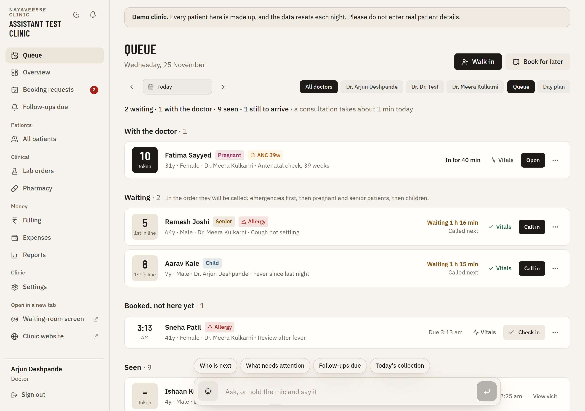

A patient in brief:

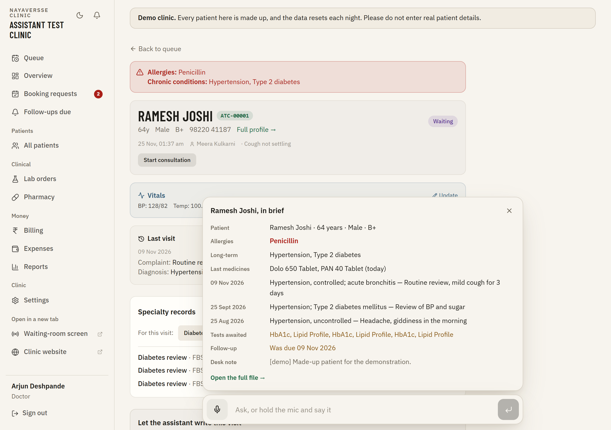

Prescribing against an allergy:

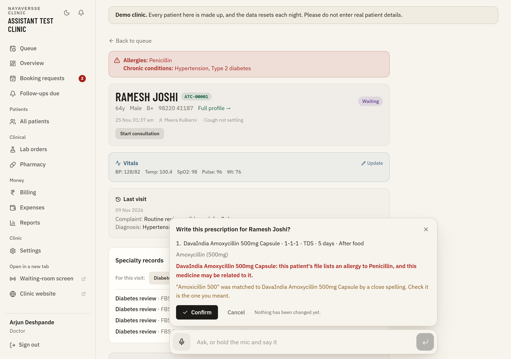

A change waits for Confirm:

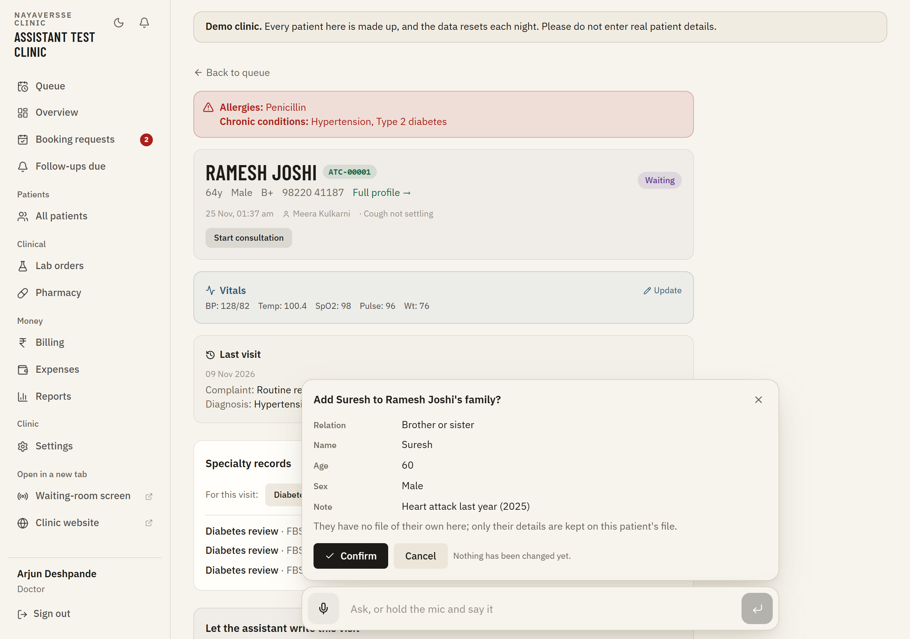

A spoken request, answered:

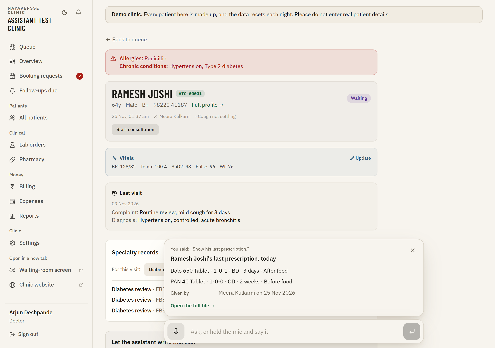

On a phone:

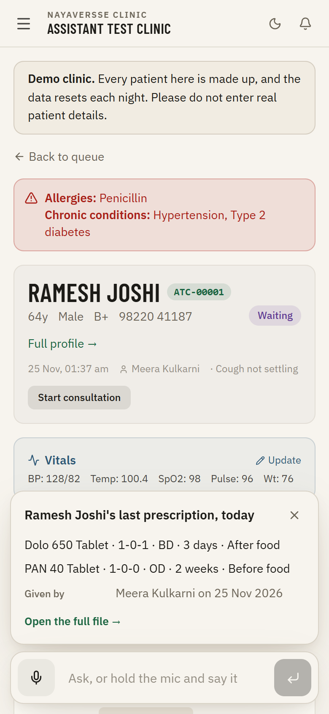

### What it refused, correctly

| Tried | Result |
|---|---|
| Reception asking it to prescribe | Refused: not on reception's list |
| Reception sending a prescription straight to the run endpoint, skipping the card | Refused: "not available to your login" |
| Reception asking for the audit log | Refused: for the clinic's admin |
| Running a lookup as if it were a change; running a change with a malformed date; running an action that does not exist | All three refused |
| Asking with no sign-in | 401 |
| "delete this patient" | It said it cannot |

### One thing it got wrong

Asked to fill the diabetes review with "he checks his feet daily", the
model set the form's Feet field to "Normal". That is a finding nobody
stated. The card showed it before anything was saved, and the model is
now told that a remark about a subject is not a finding on it; this has
not been re-measured.

## What it cost

| | |
|---|---|
| Speech-to-text, 25 seconds | about ₹0.20 at ₹0.49 a minute |
| Language model, one conversation | about 2,500 tokens in and 1,300 out on Claude Haiku 5.5: roughly 8 paise |
| A dictated note with named sections | nothing beyond the speech-to-text |
